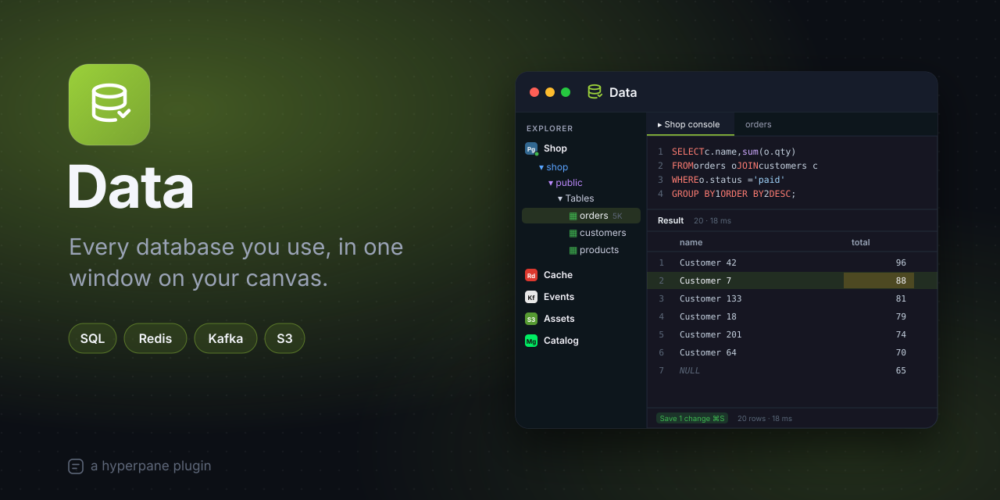

# Data

Every database you use, in one window on your canvas. Data is laid out as
DataGrip is: your saved connections in an Explorer on the left, and tabs
on the right for consoles, tables, keys, collections, topics, queues and
buckets. It connects from your server, so the databases the server can
reach are the ones you see, the same from any computer you open the
project on.

## Features

- **A home screen:** Recent connections, My connections (by group), and
  Add connection with a card for each kind, with one search over all of
  them.
- **Saved connections:** a name, a group, a color and read only; Test
  before Save; paste a connection string (`postgres://…`, `mysql://…`,
  `redis://…`, `mongodb+srv://…`) to fill in the form. Passwords and keys
  stay on the server.
- **SSH tunnels:** reach a database behind a bastion. Sign in with a key
  file, a pasted key (with its passphrase), a password or the SSH agent.
  The SSH host's key is remembered and checked.
- **TLS of your own:** a CA certificate, a client certificate and key (a
  file on the server or the PEM pasted), and the server name to check.
- **Run on connect:** statements every new PostgreSQL or MySQL connection
  runs first (a search path, a time zone, a role).
- **Options per connection:**
  - A default schema, time zone, statement timeout and application name.
  - System databases and schemas shown or hidden.
  - The rows a console gives and a table page holds.
  - A question before a console runs what changes data.
  - Keys per scan, when it disconnects for being idle, and notes on its
    card.
- **The Explorer's options (⋯):**
  - Connect or disconnect everything.
  - Sort by name, last use or kind.
  - Group or not, show details or not, show only connected ones.
- Every divider can be dragged (double-click puts it back): the Explorer,
  the console and its results, keys, messages, a bucket's preview.
- **SQL:** PostgreSQL, MySQL, MariaDB, SQLite, ClickHouse, CockroachDB,
  TimescaleDB, Supabase, Neon, Redshift, TiDB and PlanetScale.
  - **The tree:** databases, schemas, tables, views, functions, columns and
    indexes.
  - **Consoles:** completion of tables and columns, ⌘Enter for the
    statement at the cursor, Run All, Cancel, a result tab per statement,
    and the Output of every run.
  - **Tables:** paging, a WHERE filter, sorting from the header, cells
    edited in place, rows added and deleted, all saved in one transaction
    (⌘S), plus Structure and DDL.
- **Results grid:** row numbers, resizable columns, range selection, copy
  as TSV, CSV, JSON, Markdown or INSERTs, Set NULL, and a value viewer.
- **Key-value:** Redis, Valkey, Dragonfly and etcd.
  - Keys by pattern, flat or as a tree by `:`, with types and TTLs.
  - An editor for every type: string, hash, list, set, sorted set and
    stream.
  - Renaming, expiry, New key, and a console that answers as redis-cli
    does.
- **Document & search:** MongoDB, Elasticsearch, OpenSearch and DynamoDB.
  - Collections and indexes, with a filter, sort and projection.
  - Documents shown as JSON or as a table, edited, inserted and deleted.
  - Consoles in mongosh lines, Dev Tools requests or PartiQL.
- **Queues & streams:** Kafka, Redpanda, RabbitMQ and Amazon SQS.
  - Topics and queues with their figures.
  - Messages from the newest, the oldest or an offset, and a live tail.
  - Publish with a key, headers and a partition or routing key.
  - Partitions, consumer groups and their lag, and bindings.
- **Object storage:** Amazon S3, MinIO, Cloudflare R2, DigitalOcean Spaces,
  Backblaze B2 and Google Cloud Storage.
  - Buckets and folders, with upload (drop files on the list), download,
    rename and delete.
  - New folder, a preview of text and images, and links that expire.

## How to use

1. Open Data: **+** on the project, **New data**, or right-click the
   canvas.
2. On Home, pick a card under **Add connection** (PostgreSQL, Redis, S3…),
   fill in the form, **Test Connection**, then **Save and Connect**.
3. Expand the connection in the Explorer to see what's in it, and
   double-click an item (a table, a database, a topic, a bucket) to open it
   in a tab.
4. In a console, type a statement and press **⌘Enter**. In a table,
   double-click a cell to change it, and press **⌘S** to save.
5. Right-click a connection or an item for more: New Console, Edit
   Connection, Disconnect, Copy Name, and each kind's own actions.

## Good to know

- **Connections are the server's:** they're kept in Data's folder on the
  server, for every project, not in the project. Secret fields (passwords,
  keys, connection strings) are in a file of their own that only the
  server's user can read, and never go back to a window.
- **Read only** refuses edits, and console statements that look like
  writes. It's a guard, not a permission: the database's own users and
  grants are what really protect it.
- **SQLite:** a relative path is in the project's folder.
- **AWS keys:** with none given, Data uses the server's environment
  (`AWS_ACCESS_KEY_ID`…), then `~/.aws/credentials` (the profile named, or
  default).
- **Big results:** a console gives at most the limit in its toolbar (500
  rows by default); the rest isn't fetched. A PostgreSQL SELECT is read
  through a cursor, MySQL's gets a LIMIT, and ClickHouse caps it on the
  server.
- **Peeking at a queue:** RabbitMQ requeues the messages it shows (they
  come back marked redelivered), and SQS hides them for a moment. Kafka's
  are read by a consumer group of Data's own, which is deleted after.
- **SSH:** the database's host and port are as the SSH host sees them
  (`localhost` is the SSH host itself), and the SSH host must allow TCP
  forwarding. Kafka can't go through a tunnel, because its brokers give out
  their own addresses. AWS services can't either: their endpoints are
  public. If an SSH host's key changes, the connection stops; after a
  reinstall, use **Forget this SSH host's key** on the SSH tab.
- **Not yet:** Redis Cluster redirects, editing ClickHouse rows, and
  downloading a whole folder from a bucket.
- A session that's idle for 15 minutes is closed. The next thing you open
  connects again.

## How it works

The server part keeps the saved connections and one session for each
connection in use. Every query, scan and upload goes from the server, not
from the window. Drivers are loaded when first needed:

| Engine | Speaks with |
| --- | --- |
| PostgreSQL and its protocol | `pg` |
| MySQL and its protocol | `mysql2` |
| SQLite | Node's own `node:sqlite` |
| ClickHouse | its HTTP interface |
| Redis | Data's own RESP client |
| etcd | its v3 JSON gateway |
| MongoDB | `mongodb` |
| Elasticsearch, OpenSearch | their REST API |
| DynamoDB, SQS, S3 | their HTTP APIs, signed with Data's own AWS Signature V4 |
| Kafka | `kafkajs` |
| SSH tunnels | `ssh2`, in JavaScript (its native parts aren't packed) |
| RabbitMQ | its management API |

Edits to a table are statements with bound values, never pasted in, run
in one transaction. If a row changed since it was read, nothing is saved.

## Develop

```sh
./build.sh --test     # types, plugin.json, and the tests
```

The tests that need a server skip when none answers. To run them all, start
the servers with Docker:

```sh
docker run -d --name hp-data-postgres -p 5432:5432 -e POSTGRES_PASSWORD=postgres postgres:17-alpine
docker run -d --name hp-data-mysql -p 3306:3306 -e MYSQL_ROOT_PASSWORD=mysql mysql:8.4
docker run -d --name hp-data-redis -p 6379:6379 redis:7-alpine
docker run -d --name hp-data-mongo -p 27017:27017 mongo:8
docker run -d --name hp-data-kafka -p 9092:9092 apache/kafka:latest
docker run -d --name hp-data-rabbitmq -p 5672:5672 -p 15672:15672 rabbitmq:4-management
docker network create hp-data && docker network connect hp-data hp-data-postgres && docker network connect hp-data hp-data-redis
docker run -d --name hp-data-ssh --network hp-data -p 2222:2222 -e USER_NAME=tunnel -e USER_PASSWORD=tunnel -e PASSWORD_ACCESS=true lscr.io/linuxserver/openssh-server
docker exec hp-data-ssh sed -i 's/^AllowTcpForwarding no/AllowTcpForwarding yes/' /config/sshd/sshd_config && docker restart hp-data-ssh
```

The SSH tests need `HP_DATA_SSH_KEY`: a key file that the SSH server
takes, with a second one beside it (`<file>_pp`) whose passphrase is
`secret`.

## License

MIT, © 2026 Astralyx. See [LICENSE](LICENSE).
